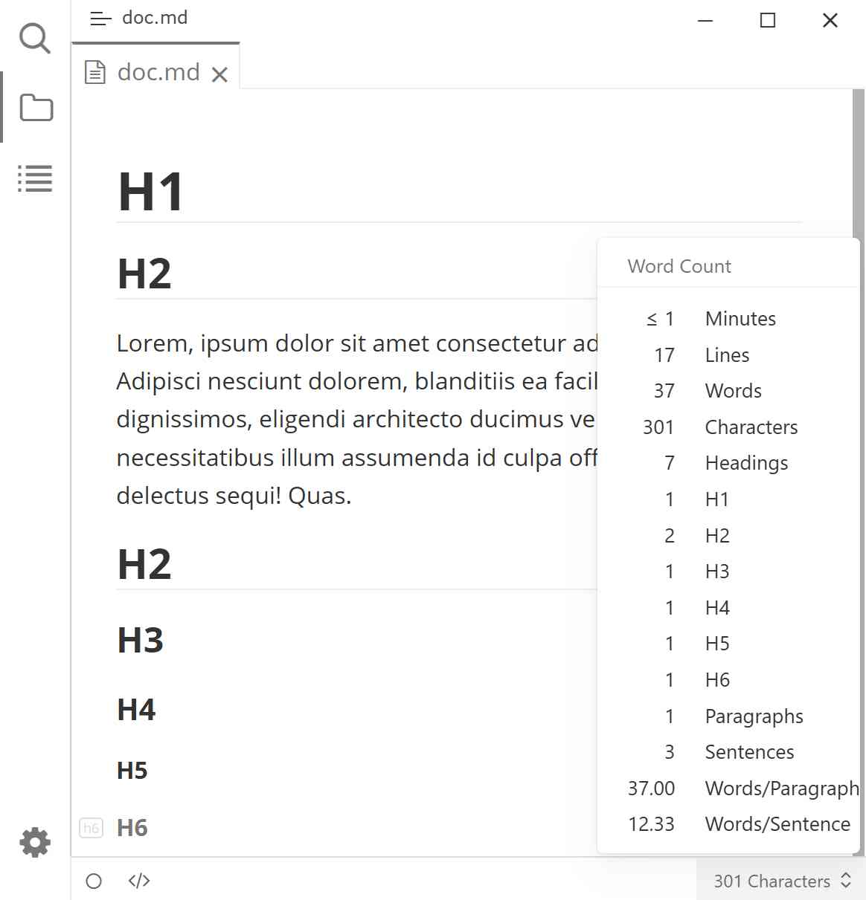

# Typora Plugin Statistics

English | [简体中文](./README.zh-CN.md)

This is a plugin based on [typora-community-plugin](https://github.com/typora-community-plugin/typora-community-plugin) for [Typora](https://typora.io).

Displays document statistics:

- Total number of headings and distribution across levels (H1–H6);
- Number of non-empty paragraphs;
- Sentence count supporting both English and Chinese delimiters (. ! ? / 。！？…);
- Average words per paragraph and average words per sentence.

When text is selected, it also displays statistics for the selection:

- Heading level distribution in selection (H1–H6);
- Number of non-empty paragraphs;
- Sentence count;
- Average words per paragraph and average words per sentence within the selection.

All items can be independently enabled or disabled in the plugin settings.

## Preview

